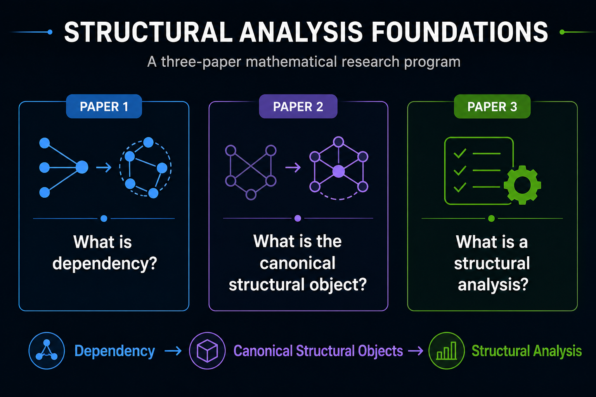

# Structural Analysis Foundations

<p align="center">
  
</p>

Structural Analysis Foundations is a three-paper research program investigating the mathematical foundations of structural analysis.

The program develops progressively:

- **Paper 1** formalizes workload-relative dependency.
- **Paper 2** defines canonical structural objects and deterministic, representation-invariant structural analysis.
- **Paper 3** investigates the minimal mathematical interface required for admissible structural analysis operators.

Together, the papers progress from a specific structural analysis, to canonical structural representations, to the general theory of structural analysis itself.

This repository is a **formal research layer**. Its mathematical definitions and accepted research objects may constrain compatible analyses, but they do not grant execution authority, establish operational necessity, or make any Continufy component mandatory.

```text
Formal definition
      ≠
Empirical validation
      ≠
Implementation
      ≠
Execution legitimacy
```

## Research Program

### Paper 1 — The Mathematics of Dependency

**Research Question:** What is dependency?

**Contribution:** Formalizes workload-relative dependency as a mathematical object, treating dependency as a property relative to a specified workload and observational context rather than as an informal graph relation.

### Paper 2 — Canonical Structural Analysis

**Research Question:** What is the canonical structural object?

**Contribution:** Develops deterministic, representation-invariant structural analysis over canonical structural objects, separating structural meaning from implementation-specific graph representations.

### Paper 3 — Foundations for Structural Analysis

**Research Question:** What characterizes a structural analysis?

**Contribution:** Investigates the minimal mathematical interface required for admissible structural analysis operators and studies foundational properties shared by structural analyses independent of any specific application.

## Research Authority and Artifact Terms

The repository uses four separate terms. The JSON records currently under `paper-*/research-objects/` are **seed records**, not authoritative research objects:

- **Authoritative research object:** an accepted, versioned research object that fixes research meaning, including its stable schema, invariants, and evidence contract. It is authoritative only for meaning within its declared scope.
- **Human-authored manuscript source:** paper-local `main.tex`, bibliography, included prose, figures, and appendices maintained by authors and reviewers. It is not a substitute for an authoritative research object.
- **Generated candidate artifact:** a rebuildable output such as `main.pdf`, HTML preview, graph export, or validation report. It is evidence for review and has no publication status.
- **Immutable release artifact:** a reviewed, committed `pdf/paperN.pdf` or future versioned release bundle published from an identified source commit and then left unchanged.

For the same research meaning, authority is ordered: **authoritative research object, then human-authored manuscript source, then immutable release artifact**. Implementations are conformance hypotheses against authoritative research objects, not the source of their authority.

Canonical authority is an explicit status separate from maturity and editorial lifecycle. A seed remains noncanonical until source extraction and dependencies are checked, validation evidence and review are recorded, and canonical authority is explicitly assigned. See [Research-object lifecycle and authority](docs/research-object-lifecycle.md).

Current governance and review documentation includes:

- [Minimal Promotion Contract](docs/minimal-promotion-contract.md) — consumer-side review contract for immutable Promotion Packages and bounded formalization authorization.
- [Consumer Promotion Records](promotion-records/README.md) — immutable package snapshots, admissibility reviews, and bounded promotion decisions emitted under that contract.

A promotion decision is bounded to this repository's research authority. It does not confer operational authority on another system.

## Canonical Structural Architecture

Additional research objects should define scientific purpose, inputs, outputs, invariants, preconditions, postconditions, evidence contract, reproducibility requirements, canonical schema, and deterministic fixtures before an implementation-specific adapter is introduced.

Canonical fixtures are validated against their declared Draft 2020-12 JSON Schemas with `python tools/validate_canonical_fixtures.py` after installing `requirements.txt`; CI runs the same check before conformance adapters.

```text
Real System
  ↓
Canonical Structural Object
  ↓
Canonical Research Object
  ↓
Specific Analysis
```

This diagram describes a formalization path used by this research program. It is **not a claim that every structural tool, Continufy workflow, or production system must instantiate each stage**.

## Relationship to the Continufy Ecosystem

Structural Analysis Foundations may provide formal definitions that other Continufy repositories consume. Those relationships are optional and evidence-dependent.

For example, SYNAPSE may implement or test conformance against accepted structural definitions; Architectural Boundary Research may provide empirical evidence relevant to candidate formalizations; Methodology Engineering may define processes used to investigate or promote them.

None of those relationships is automatically required.

```text
Research relationship ≠ runtime dependency
Formal compatibility ≠ architectural necessity
Mathematical validity ≠ operational value
Formal authority ≠ execution authority
```

Evidence-supported outcomes may include a definition being reused directly, specialized for a narrower domain, superseded by a simpler formal object, unsupported outside its research scope, or absent from a production path.

The repository therefore does not establish a fixed Continufy topology. Cross-repository dependencies must be justified by the consumer and, where consequential, tested empirically.

## Evidence Boundary

The trilogy can support mathematical and formal claims within the scope of its definitions, proofs, assumptions, and accepted research objects. It does not by itself establish:

- empirical recurrence across real software systems;
- engineering usefulness;
- predictive value for operational outcomes;
- necessity of a Continufy component;
- execution legitimacy;
- customer value;
- willingness to pay; or
- commercial viability.

Those require evidence appropriate to those claims.

A useful falsification question for downstream adoption is:

> Does using these formal structural objects improve consequential analysis or engineering decisions compared with a strong simpler baseline?

## Current Repository Status

Immutable PDF release artifacts are present at:

- [paper-1-dependency/pdf/paper1.pdf](paper-1-dependency/pdf/paper1.pdf)
- [paper-2-canonical-structural-analysis/pdf/paper2.pdf](paper-2-canonical-structural-analysis/pdf/paper2.pdf)
- [paper-3-foundations-structural-analysis/pdf/paper3.pdf](paper-3-foundations-structural-analysis/pdf/paper3.pdf)

Current source status: `main.tex` and `references.bib` are present in each paper directory; local LaTeX builds require LaTeX tooling such as `latexmk` or `pdflatex`.

## Continuous LaTeX Validation

This repository is self-validating through `.github/workflows/latex.yml`. The workflow builds each paper independently with `latexmk -pdf main.tex` in a maintained TeX Live environment.

A successful build establishes reproducibility of the declared manuscript build under that environment. It does not independently validate the truth, generality, empirical usefulness, or commercial value of the paper's claims.

### Local Build Instructions

```sh
cd paper-1-dependency && latexmk -pdf main.tex
cd ../paper-2-canonical-structural-analysis && latexmk -pdf main.tex
cd ../paper-3-foundations-structural-analysis && latexmk -pdf main.tex
```

Local builds generate candidate `main.pdf` artifacts and LaTeX auxiliary files beside each `main.tex`. Do not overwrite immutable release artifacts under `pdf/`. Publication requires the acceptance and release transition defined in `REPRODUCIBILITY.md`.

## Repository Organization

- `paper-1-dependency/` — Paper 1: The Mathematics of Dependency
- `paper-2-canonical-structural-analysis/` — Paper 2: Canonical Structural Analysis
- `paper-3-foundations-structural-analysis/` — Paper 3: Foundations for Structural Analysis
- `figures/` — top-level figure organization by paper

Each paper can be compiled independently. The trilogy forms a progressive research program; that progression is internal to the research program and does not imply a mandatory external software pipeline.
